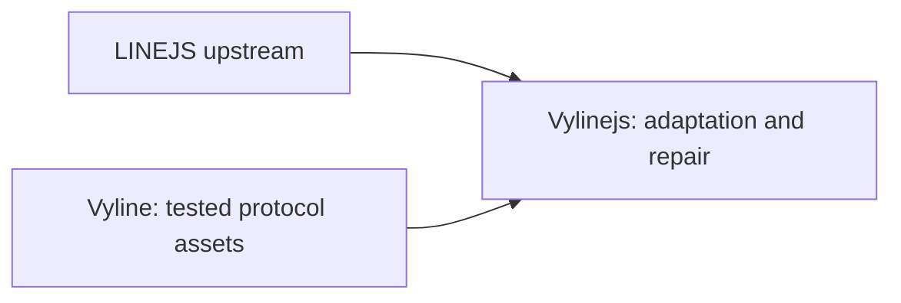

# Vylinejs

Vylinejs is a downstream integration based on
[LINEJS](https://github.com/evex-dev/linejs), maintained at
[nezumi0627/Vylinejs](https://github.com/nezumi0627/Vylinejs). LINEJS remains
the protocol and API foundation; portable protocol work from
[Vyline](https://github.com/nezumi0627/vyline) is integrated here and can flow
into the library where its behavior fits a portable API.

## Why Vylinejs

- **Familiar API:** built on LINEJS, so existing concepts and usage stay familiar
  wherever compatibility allows.
- **Quick adaptation:** as an independent fork, Vylinejs can respond directly to
  new LINE protocol changes and user requests, with frequent maintenance and
  room to evolve its API when needed.
- **Performance work:** hot paths are measured and optimized to reduce CPU time
  and unnecessary allocations and copies. See the [stability notes](docs/VYLINEJS_STABILITY.md)
  for benchmarks and their limits.
- **Independent maintenance:** protocol changes and user requests can be
  addressed within the Vylinejs repository and release cycle.

Vylinejs aims to combine LINEJS's familiar interface with the flexibility and
short iteration cycle of an independently maintained fork.

See [the project comparison and porting history](docs/VYLINE_PORTING.md) for
the differences between LINEJS, Vyline, and Vylinejs. The [stability notes](docs/VYLINEJS_STABILITY.md)
cover queue limits, issue status, and measured performance results.

The JSR package `@nezumi0627/vylinejs` contains the client, protocol types, and
public subpaths. npm and Bun projects can install it through JSR's npm
compatibility layer. The migration from `@evex/linejs` is
covered in the [migration guide](docs/docs/migration.md). This is an unofficial
LINE client library.
