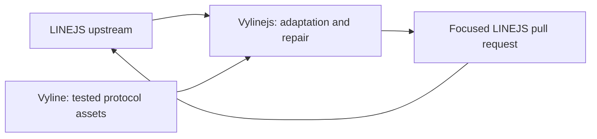

# Vylinejs

Vylinejs is a downstream integration based on
[LINEJS](https://github.com/evex-dev/linejs), maintained at
[nezumi0627/Vylinejs](https://github.com/nezumi0627/Vylinejs). LINEJS remains
the protocol and API foundation; portable protocol work from
[Vyline](https://github.com/nezumi0627/vyline) is integrated here and can flow
back upstream as focused pull requests.

See [the porting guide](docs/VYLINE_PORTING.md) for provenance and
[the stability notes](docs/VYLINEJS_STABILITY.md) for queue limits, issue
status, and measured FileStorage performance.

Import names remain `@evex/linejs` for source compatibility. The project and
GitHub releases are Vylinejs. This is an unofficial LINE client.
