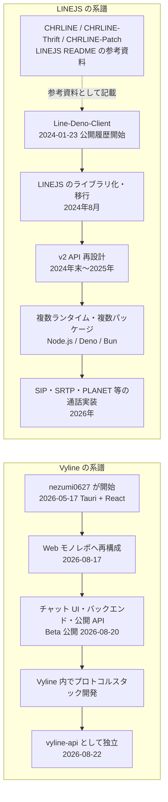
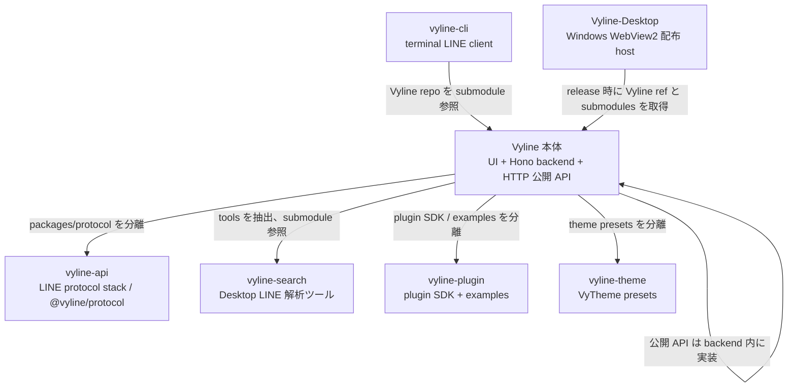
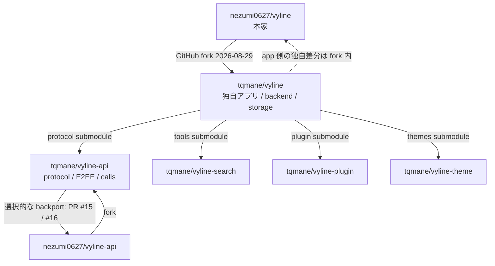

# Vyline と LINEJS のルーツと歴史

調査日: 2026-10-20\
対象: [nezumi0627/Vyline](https://github.com/nezumi0627/Vyline) /
[evex-dev/linejs](https://github.com/evex-dev/linejs)

## 結論

- **Vyline** は [nezumi0627](https://github.com/nezumi0627)
  が始めた独立プロジェクト。2026-05-17 に Tauri + React の試作として開始し、Web
  クライアント、バックエンド、独自プロトコルへ発展した。
- **LINEJS** は [Piloking](https://github.com/piloking) が README 上の Owner &
  Developer。JavaScript / Deno を起点とする LINE SelfBot ライブラリで、現在の
  README には共同開発者として
  [EdamAme-x](https://github.com/EdamAme-x)、[MocA-Love](https://github.com/MocA-Love)、[Hafusun](https://github.com/hafusun)
  が記載されている。
- LINEJS README は
  [CHRLINE](https://github.com/DeachSword/CHRLINE)、[CHRLINE-Thrift](https://github.com/DeachSword/CHRLINE-Thrift)、[CHRLINE-Patch](https://github.com/WEDeach/CHRLINE-Patch)
  を参考資料として列挙している。
- 公開 Git 履歴・README・Vyline の submodule 定義からは、**Vyline が LINEJS の
  fork や移植として始まった証拠は確認できない**。一方で nezumi0627 は Vyline
  開始前後に LINEJS へ複数の PR
  を提出しており、開発者間の公開上の接点はある。これらは未マージで、Vyline
  へのコード移植や設計継承の証明にはならない。

## Vyline の歴史

### 1. 2026-05-17 — Tauri + React の試作として開始

最初のコミットは
[`f09bf48`](https://github.com/nezumi0627/Vyline/commit/f09bf48e7c209080f9afe691f2a1d0efaa146c59)
`Initial commit: Vyline Tauri + React Hello World`。同日の次のコミット
[`34248c1`](https://github.com/nezumi0627/Vyline/commit/34248c1) で、primary /
secondary device のログイン画面を追加している。

これは最初から完成した Web
メッセンジャーとして始まったのではなく、デスクトップアプリの骨組みと LINE
ログインを先に試した始まりだったことを示す。

### 2. 2026-08-17 — Web クライアントへ大きく方向転換

[`6a7f10a`](https://github.com/nezumi0627/Vyline/commit/6a7f10a)
`Restructure into Vyline web monorepo, drop Tauri desktop traces` で Tauri
の痕跡を削除し、Web モノレポとして再構成した。README と構成は React UI、Bun 上の
Hono バックエンド、プロトコルパッケージを分けた現在の方向につながる。

### 3. 2026-08-20 — Beta 公開とユーザー向け機能の具体化

履歴には [`16a7605`](https://github.com/nezumi0627/Vyline/commit/16a7605)
`v0.5.0-beta: fetchOps reception, public API, Vyline Desktop teaser`
がある。同じ時期にチャット同期、公開 API、Docker /
配布経路、編集・取り消し・リアクションなどの機能が加わり、プロトコル試作が日常利用を意識したクライアントへ移っていく。

README は 2026-08-20 を Beta 0.5.0 の公開開始日として記載している。

### 4. 2026-08-22 — 独自プロトコルを別リポジトリへ分離

Vyline の
[`.gitmodules`](https://github.com/nezumi0627/Vyline/blob/main/.gitmodules) は
`Vyline/packages/protocol` を
[nezumi0627/vyline-api](https://github.com/nezumi0627/vyline-api)
に結び付けている。`vyline-api` の初期コミット
[`763f8ec`](https://github.com/nezumi0627/vyline-api/commit/763f8ec) は
`initial: Vyline LINE protocol stack (moved from nezumi0627/vyline packages/protocol)`
と明記する。

したがって、確認できる実装の流れは **Vyline 内でプロトコル実装を始める →
再利用・分離しやすい独立パッケージとして切り出す** というもの。

### Vyline の作者・貢献者

- **作者 / リード開発者:** [nezumi0627](https://github.com/nezumi0627) — Vyline
  README のメンテナー欄ではリード開発者。
- **定期メンテナー:** [YoseiUshida](https://github.com/youseiushida) — 同 README
  のメンテナー欄に記載。2026-08-21 の履歴にもストレージや Docker
  周りの修正がある。

## LINEJS の歴史

### 1. 2024-01-23 — 「Line-Deno-Client」として公開履歴が始まる

最初のコミットは
[`13d6a43`](https://github.com/evex-dev/linejs/commit/13d6a435aea584d4d48b3979a2f92e9934c7e819)
`Initial commit`。初期 README の題名は `Line-Deno-Client`
で、初期のファイル群にも `read_deno.js`、`write_deno.js`、`line_types_deno.js`
など Deno を意識した名前が見える。現行の汎用ライブラリより、当初は Deno で LINE
の API / Thrift 通信を扱う小さなクライアントという姿だった。

注意点として、この最初のコミットの Git author は `test0987654321234567890`。現行
README の Owner & Developer 表記は Piloking であり、公開リポジトリ上の最初の
author
表示と現行のプロジェクト責任者表記は同一ではない。公開資料だけでは、このアカウント名の経緯や初期の役割分担までは断定できない。

### 2. 2024-08 — EdamAme-x の参加と構造の大幅な移行

2024-08-01 に [EdamAme-x](https://github.com/EdamAme-x) の formatter
変更が履歴に現れ、8月中旬以降は `migrate`、`strict types`、API
整理、ドキュメント・リリース整備が続く。これは単なる名称変更というより、初期の
Deno
スクリプト群をライブラリとして保守・配布しやすい構成に整えていく転換期と読める。

この段階で README は `LINEJS` を LINE SelfBot 用 JavaScript
ライブラリとして説明するようになり、現在のプロジェクト名と目的が明確になった。なお、Git
のコミット件名だけでは、個々の変更の設計動機までは分からないため、ここでは履歴から確認できる変化に限っている。

### 3. 2024年末〜2025年 — v2 の再設計

2024-12-28 には Deno KV storage、12-29 に migration 機能、12-30 に `to v2`
のドキュメント変更がある。2025年初頭には `v2` ブランチの統合が続く。現行 README
も v1 から v2 への API 面の大きな変更に触れており、v2
は後方互換の小改修ではなく、利用者側の移行を伴う API 再設計として扱われている。

### 4. 2025〜2026 — Deno 専用から複数ランタイム対応へ

現在の README は Node.js、Deno、Bun をサポート対象として案内し、JSR
から配布する。ライブラリ本体だけでなく、型定義、Thrift、ストレージ、Agent
関連などを複数パッケージに分けるモノレポへ成長している。

履歴の 2026年5月には Node.js 対応や Android APK から Thrift
定義を同期する仕組み、CHRLINE-Patch
からのサービスメソッド移植と、その後のマニフェスト駆動生成への変更が見える。つまり外部のサービス一覧をそのまま抱え続けるのではなく、移植した
API 群をリポジトリ内で生成・保守する方向へ進んだ。

### 5. 2026-05 — 通話機能をプロトコル実装まで拡張

2026-05-20 以降の履歴に、SIP、SDP、SRTP、MIKEY、Opus、ICE / STUN、LINE 固有の
PLANET / Cassini 通信の実装が連続して現れる。通話制御の API
を足すだけでなく、音声メディアの経路まで段階的に掘り下げている。

ここは LINEJS の性格が「チャット自動化用クライアント」から、LINE
の複数サービス・プロトコルを扱う汎用性の高い低レイヤーライブラリへ広がった大きな節目。

### LINEJS の公開上の作者・開発者

README の Authors 欄に基づく表記:

- **Owner & Developer:** [Piloking](https://github.com/piloking)
- **Developer:** [EdamAme-x](https://github.com/EdamAme-x)
- **Developer:** [MocA-Love](https://github.com/MocA-Love)
- **Developer:** [Hafusun](https://github.com/hafusun)

これは README に載るプロジェクト上の役割であり、Git
履歴に現れる全コントリビューター一覧とは異なる。特に初期コミット author と
README の Owner
表記には差があるので、初期の個人史を補うには当時の作者による追加説明が必要。

## 2つの系譜を並べた図

図は公開リポジトリで確認できる関係だけを示す。左右をつなぐ派生矢印は確認できない。

## 比較

| 観点                | LINEJS                                | Vyline                                                           |
| ------------------- | ------------------------------------- | ---------------------------------------------------------------- |
| 公開 Git 履歴の起点 | 2024-01-23                            | 2026-05-17                                                       |
| 作者表記            | README: Owner & Developer は Piloking | 作者 / リード開発者: [nezumi0627](https://github.com/nezumi0627) |
| 初期形態            | Deno を意識した `Line-Deno-Client`    | Tauri + React のデスクトップ試作                                 |
| 主な方向            | LINE SelfBot 用 JS/TS ライブラリ      | UI と独自プロトコルを持つ LINE クライアント                      |
| 公開された参考系譜  | README に CHRLINE 系を列挙            | README / Git 履歴に LINEJS からの派生記録なし                    |
| プロトコルの扱い    | LINEJS モノレポ内で発展               | Vyline 内で始め、`vyline-api` に分離                             |

## 根拠・参照先

### Vyline

- [Vyline リポジトリ](https://github.com/nezumi0627/Vyline)
- [初期コミット: Tauri + React Hello World](https://github.com/nezumi0627/Vyline/commit/f09bf48e7c209080f9afe691f2a1d0efaa146c59)
- [Web モノレポへ再構成](https://github.com/nezumi0627/Vyline/commit/6a7f10a)
- [Beta 0.5.0 の履歴](https://github.com/nezumi0627/Vyline/commit/16a7605)
- [Vyline README](https://github.com/nezumi0627/Vyline/blob/main/README.md)
- [submodule 定義](https://github.com/nezumi0627/Vyline/blob/main/.gitmodules)
- [vyline-api 初期コミット](https://github.com/nezumi0627/vyline-api/commit/763f8ec)

### LINEJS

- [LINEJS リポジトリと Authors / References](https://github.com/evex-dev/linejs)
- [初期コミット](https://github.com/evex-dev/linejs/commit/13d6a435aea584d4d48b3979a2f92e9934c7e819)
- [LINEJS 公式ドキュメント](https://linejs.evex.land/)
- [Piloking](https://github.com/piloking) /
  [EdamAme-x](https://github.com/EdamAme-x) /
  [MocA-Love](https://github.com/MocA-Love) /
  [Hafusun](https://github.com/hafusun)
- [CHRLINE](https://github.com/DeachSword/CHRLINE) /
  [CHRLINE-Thrift](https://github.com/DeachSword/CHRLINE-Thrift) /
  [CHRLINE-Patch](https://github.com/WEDeach/CHRLINE-Patch)

## 調査範囲と限界

このまとめは公開 Git 履歴、README、submodule
設定、公式ドキュメントを基にしている。LINEJS の初期コミットは README だけで、Git
author 表示も現行 README の Owner
表記と異なる。そのため「誰が最初にアイデアを出したか」「初期作者間でどう引き継がれたか」は確定できない。また、Vyline
と LINEJS
の直接関係が見つからないという記述は、公開資料に証拠がないという意味であり、公開されていない会話や個人的な参考経験を否定するものではない。

## PR・コミットから見える貢献者とメンテナンス

ここでは GitHub の Authors 欄だけでなく、マージ済み PR の内容と Git
履歴を見て、実際にどの領域を支えたかを整理する。GitHub の contributor
件数はメール紐付けやブランチ、集計時点で変わるため、役割の確定根拠には使わない。

### Vyline — 小規模なメンテナーチームと少数の外部貢献

#### 継続的なメンテナンス

- **[nezumi0627](https://github.com/nezumi0627)** — README
  上のリード開発者。機能開発、プロトコル・バックエンド・UI、リリース整備を広く担当している。公開
  PR 履歴でも多数の PR を自ら作成・マージしており、実質的な主担当。
- **[YoseiUshida](https://github.com/youseiushida)** — README
  上の定期メンテナー。2026年8月には Docker
  の初回同期・ログ保存修正（[#19](https://github.com/nezumi0627/Vyline/pull/19)）、CI
  / Docker
  ビルド修正（[#61](https://github.com/nezumi0627/Vyline/pull/61)）、実行時依存と起動
  smoke
  test（[#66](https://github.com/nezumi0627/Vyline/pull/66)）がマージされている。運用・配布・CI
  の保守に明確な貢献がある。
- **[takano32](https://github.com/takano32)** — PR
  [#153](https://github.com/nezumi0627/Vyline/pull/153) でデバイス確認 PIN を
  CSPRNG で生成する修正を提供。セキュリティ寄りの外部貢献。
- **[yuz-mc / y2mc](https://github.com/yuz-mc)** — ロゴ提案 PR
  [#294](https://github.com/nezumi0627/Vyline/pull/294)
  がマージ。ブランド・ビジュアル面の貢献。

`tqmane` による本家 Vyline への UI / Android データベース取り込み関連
PR（[#142](https://github.com/nezumi0627/Vyline/pull/142)、[#165](https://github.com/nezumi0627/Vyline/pull/165)、[#171](https://github.com/nezumi0627/Vyline/pull/171)）はいずれもクローズ・未マージ。ただし、その後
[tqmane/vyline](https://github.com/tqmane/vyline) という独立した fork を作り、非
UI
の通話・保存・認証・プロトコルにも大きく手を入れている。また、プロトコル側の一部は
`nezumi0627/vyline-api` へ PR として戻されている。詳細は後述する。

#### メンテナンスの形

公開履歴では、Vyline は現時点で **nezumi0627
が大半の実装・統合を担い、YoseiUshida
が運用周辺を継続支援し、必要に応じて個別の機能・デザイン貢献が入る**形に見える。これは
PR の公開活動からの整理であり、GitHub
の非公開な権限設定や私的な役割分担を断定するものではない。

### LINEJS — コア開発者と機能別コミュニティ貢献

#### コア開発・リリース

- **[Piloking](https://github.com/piloking)** — README の Owner &
  Developer。2024年末〜2025年初頭の v2
  系変更や、継続的なコア保守にコミットがある。
- **[EdamAme-x](https://github.com/EdamAme-x)** — README の
  Developer。2024年8月の移行期から大きく貢献し、現行の機能開発・PR統合・リリース作業の中心。2026年5月の
  E2EE / Thrift 同期 / CHRLINE-Patch サービス移植・生成方式整理、9月の v3.4.0
  系リリース履歴にも登場する。
- **[MocA-Love](https://github.com/MocA-Love)**、**[Hafusun](https://github.com/hafusun)**
  — README の Developer 欄に記載。公開 Authors 欄の役割を記録し、全 PR
  の担当者と同一視しない。

#### 主な外部貢献者と実例

- **[Madoa5561](https://github.com/Madoa5561)** — 2025年末〜2026年3月に Square /
  VOOM 周辺の操作追加、LEGY polling / fetch、利用例、disabled client
  対応など複数の PR
  がマージ。[#107](https://github.com/evex-dev/linejs/pull/107)、[#111](https://github.com/evex-dev/linejs/pull/111)、[#112](https://github.com/evex-dev/linejs/pull/112)、[#113](https://github.com/evex-dev/linejs/pull/113)、[#120](https://github.com/evex-dev/linejs/pull/120)、[#121](https://github.com/evex-dev/linejs/pull/121)、[#122](https://github.com/evex-dev/linejs/pull/122)、[#123](https://github.com/evex-dev/linejs/pull/123)、[#124](https://github.com/evex-dev/linejs/pull/124)。
- **[frankekn](https://github.com/frankekn)** — 2026年の Thrift
  スキーマ同期、APK 解析の安全化、E2EE / OBS / push / polling
  の修正を複数提供。特に
  [#231](https://github.com/evex-dev/linejs/pull/231)、[#232](https://github.com/evex-dev/linejs/pull/232)、[#233](https://github.com/evex-dev/linejs/pull/233)、[#234](https://github.com/evex-dev/linejs/pull/234)、[#235](https://github.com/evex-dev/linejs/pull/235)、[#237](https://github.com/evex-dev/linejs/pull/237)、[#239](https://github.com/evex-dev/linejs/pull/239)、[#240](https://github.com/evex-dev/linejs/pull/240)
  は保守性とプロトコル整合性を支えるまとまった貢献。
- **[dryob](https://github.com/dryob)** —
  [#241](https://github.com/evex-dev/linejs/pull/241) と
  [#242](https://github.com/evex-dev/linejs/pull/242) で PLANET
  の応答相関、リモート切断、グループ通話メディアの処理を修正。
- **[kyo5uke](https://github.com/kyo5uke)** —
  [#225](https://github.com/evex-dev/linejs/pull/225)
  の編集メッセージイベント、[#228](https://github.com/evex-dev/linejs/pull/228)
  の履歴取得時 `isEdited` 修正。
- **[enkunkun](https://github.com/enkunkun)** — Album / Moa REST
  サービス（[#214](https://github.com/evex-dev/linejs/pull/214)）、直近メッセージ取得
  API（[#213](https://github.com/evex-dev/linejs/pull/213)）、セッション保存ドキュメント（[#212](https://github.com/evex-dev/linejs/pull/212)）。
- **[TsungPao](https://github.com/TsungPao)** —
  [#210](https://github.com/evex-dev/linejs/pull/210)
  で友だち追加リクエストのシリアライズを修正。v3.2.1
  リリースノートで初回貢献者として記載。
- **[botnick](https://github.com/botnick)** —
  [#196](https://github.com/evex-dev/linejs/pull/196) で ID /
  電話番号による連絡先検索・友だち追加 API
  を追加し、通話修正にも共同著者として参加。
- **[mimimiku778](https://github.com/mimimiku778)** — Square / VOOM
  の投稿・メディア操作を追加（[#206](https://github.com/evex-dev/linejs/pull/206)、[#208](https://github.com/evex-dev/linejs/pull/208)）。

#### メンテナーの見え方

README が明記する Owner & Developer は Piloking、Developer は EdamAme-x /
MocA-Love / Hafusun。PR履歴上では EdamAme-x
がレビュー・統合・リリースを非常に多く担い、Piloking
がオーナー兼コア開発者として継続参加し、Madoa5561、frankekn
らが機能領域を分担する構図が見える。ここでいう「メンテナー」は README
の役割と統合活動からの整理で、GitHub の管理者権限そのものを指すとは限らない。

### 2つのプロジェクト間で確認できる接点

nezumi0627 は Vyline の初期コミットより前の 2025-12-30 に LINEJS へ PR
を提出している。

- [#97 — Push protocol のロジックをクラスに分離](https://github.com/evex-dev/linejs/pull/97)
  — 2025-12-30 作成、2026-08-28 クローズ、未マージ。
- [#105 — ForSecure QR ログインと安定性改善](https://github.com/evex-dev/linejs/pull/105)
  — 2025-12-30 作成、未マージでクローズ。
- [#106 — ForSecure QR ログイン方式](https://github.com/evex-dev/linejs/pull/106)
  — #105 の一部を分けた PR。2025-12-31 作成、2026-05-20 クローズ、未マージ。

この履歴は、nezumi0627 が LINEJS のコードや開発に触れたことを示す。しかし PR
が採用・マージされた記録はなく、Vyline の初回コミットは 2026-05-17
なので、**この接点だけから Vyline の実装が LINEJS
由来だとは言えない**。対照的に、Vyline のプロトコル実装が `vyline-api`
に移動した来歴は submodule と移動コミットに明記されている。

## 集計について

GitHub の contributors API
は取得時点のコミット集計を返すが、メールアドレスの紐付け、デフォルトブランチ、書き換え履歴などで表示対象が変わる。PR
はクローズ済み未マージも含めて状態を個別確認した。ここではランキングより、実例を追えるマージ済み
PR と README の役割表記を優先している。

## Vyline 周辺リポジトリ群 — 分離の経緯と役割

nezumi0627 の公開 repo と Vyline 本体の submodule /
開発者向け資料を照合すると、Vyline は単一 repo
のまま大きくなるのではなく、プロトコル、解析ツール、拡張
SDK、テーマ、CLI、デスクトップ配布層を順に分けた構成へ広がっている。以下は
Vyline README・submodule・各 repo の README と初期コミットから追えた関連 repo。

### 全体図

矢印はコードの移動・参照・ビルド依存を示し、所有権や開発チームが別という意味ではない。`vyline-api`
は名前に API とあるが、Vyline の主に LINE wire protocol
を実装するパッケージ。Vyline アプリ利用者向けの HTTP / OpenAPI 公開 API
は、本体の backend にある別の層。

### 1. Vyline 本体 — 統合アプリと公開 HTTP API

[nezumi0627/vyline](https://github.com/nezumi0627/vyline) は 2026-05-17 の
Tauri + React 試作から始まり、2026-08-17 に Web モノレポへ再構成された。現在の
README では React + Vite UI、Bun 上の Hono
backend、自前プロトコルを組み合わせるアプリとして説明されている。

この repo 自身が提供する **公開 HTTP API** は OpenAPI 3.1
定義を持つ。ドキュメントは Swagger UI を
[vyline-api GitHub Pages](https://nezumi0627.github.io/vyline-api/)
で公開し、OpenAPI 定義を本体 main から生成すると説明する。これは API
プロトコル実装 repo の `@vyline/protocol` とは役割が異なる。

### 2. `vyline-api` — プロトコルスタックの独立化

[nezumi0627/vyline-api](https://github.com/nezumi0627/vyline-api)
の初期コミットは 2026-08-22 の
`initial: Vyline LINE protocol stack (moved from nezumi0627/vyline packages/protocol)`。Thrift
RPC、ログイン、E2EE、OBS、timeline、通話などを含む `@vyline/protocol`
パッケージとして、Vyline 内の `Vyline/packages/protocol`
から移動したことがコミット本文に明記される。

その後の PR では、nezumi0627 によるアルバム / Moa 対応、iOS note、認証 token
lifecycle、OBS / LIFF などの拡張が続く。外部貢献では
**[tqmane](https://github.com/tqmane)** の
[PR #15](https://github.com/nezumi0627/vyline-api/pull/15)
が、transport、media、token refresh を堅牢化。続く
[PR #16](https://github.com/nezumi0627/vyline-api/pull/16) で追加の call / media
/ protocol 改善を統合している。API
は単なる過去コード置き場でなく、分離後も独立に更新される中核ライブラリ。

### 3. `vyline-search` — Desktop LINE 解析ツールの切り出し

[nezumi0627/vyline-search](https://github.com/nezumi0627/vyline-search)
の初期コミットは 2026-08-16。コミット文は「Standalone unpack / native symbol
search / decompile toolkit … extracted from Vyline」と記録し、Vyline の
`findNativeSymbol` / `focusRecoveredSource` などを抽出した由来を明示する。

用途は LINE Desktop の更新・バージョン確認、Themida 保護実行ファイルの
unpack、ネイティブシンボル探索、Ghidra による逆コンパイル。2026-08-20 には
Vyline 側が旧 `tools/` を submodule に置き換え、実装の保守先を独立 repo
に移した。Vyline README は教育・学習・セキュリティ研究向けと用途を限定している。

### 4. `vyline-plugin` — プラグイン SDK とサンプル

[nezumi0627/vyline-plugin](https://github.com/nezumi0627/vyline-plugin) は
2026-08-22 に `plugin foundation (sdk + examples)` として開始。翌 8-23 の本体 PR
/ commit [`a5b7266`](https://github.com/nezumi0627/vyline/commit/a5b7266)
で、それまで本体内にあった plugin SDK を独立 repo の submodule として分離した。

repo は `@vyline/plugin-sdk` と `definePlugin` API、最小プラグイン・message
logger・設定デモを管理する。本体は SDK の型とサンプルを submodule
から取り込み、実行時の権限チェックは Vyline backend と連携する。2026-09-21 の PR
#1 / #2 では SDK permission と runtime の整合性、型の整形を調整している。

### 5. `vyline-theme` — テーマプリセットの独立管理

[nezumi0627/vyline-theme](https://github.com/nezumi0627/vyline-theme) は
2026-08-22 の `feat: VyTheme presets package (@vyline/themes)`
で始まった。テーマプリセットを本体 UI から切り離して `@vyline/themes`
として提供し、色・背景・角丸などの VyTheme token と preset
の変更を独立管理する。

8-23 の本体 [`a5b7266`](https://github.com/nezumi0627/Vyline/commit/a5b7266)
は、plugin と theme の両方を submodule 化した分離コミット。公開履歴上、テーマ
repo は独立後の外部 PR よりも作者自身による小規模な修正が中心。

### 6. `vyline-cli` — 同じ protocol を使う端末クライアント

[nezumi0627/vyline-cli](https://github.com/nezumi0627/vyline-cli) は 2026-08-23
に初期実装。コミットには QR / Email / token login、chat
一覧、send、messages、watch が列挙される。README は Vyline の `@vyline/protocol`
を利用し、ログインから送受信までを terminal 内で完結すると説明する。

この repo は protocol stack を独自コピーせず、**Vyline 本体 repo を git
submodule として参照**する。つまり CLI はアプリ本体から protocol を再利用する別
UI クライアント。公開履歴で確認できる初期実装・保守の主担当は nezumi0627。

### 7. `Vyline-Desktop` — Windows 配布 host

[nezumi0627/Vyline-Desktop](https://github.com/nezumi0627/Vyline-Desktop) は
2026-08-26 に Electron beta として開始したが、同日 PR #3 で「WebView2
distribution host」に整理された。現在の README では、本体や backend / protocol /
plugin / theme を複製して保守せず、release 時に指定した Vyline ref と submodule
を取得して WebView2 host と backend sidecar を組み立てると説明される。

これは Vyline の別実装というより、既存 Web アプリを Windows desktop
で配布・起動する薄い host / installer 層。Beta 検証用として扱われており、本体
README の「Vyline Desktop 公開予定」記述より後に専用 repo が作られている。

## 分離の時系列

| 日付          | 変化                                                       | 根拠                                                                                                                                                                                                   |
| ------------- | ---------------------------------------------------------- | ------------------------------------------------------------------------------------------------------------------------------------------------------------------------------------------------------ |
| 2026-05-17    | Vyline Tauri + React 試作開始                              | [初期コミット](https://github.com/nezumi0627/Vyline/commit/f09bf48e7c209080f9afe691f2a1d0efaa146c59)                                                                                                   |
| 2026-08-16    | `vyline-search` を本体の解析コードから独立 repo 化         | [Search 初期コミット](https://github.com/nezumi0627/vyline-search/commit/5171a8a4)                                                                                                                     |
| 2026-08-20    | 本体 `tools/` を Search submodule に置換                   | [本体 commit](https://github.com/nezumi0627/Vyline/commit/20b8080)                                                                                                                                     |
| 2026-08-22    | `packages/protocol` を `vyline-api` へ移動                 | [API 初期コミット](https://github.com/nezumi0627/vyline-api/commit/763f8ec)                                                                                                                            |
| 2026-08-22–23 | plugin SDK と VyTheme presets を各 repo / submodule に分離 | [本体分離 commit](https://github.com/nezumi0627/Vyline/commit/a5b7266)                                                                                                                                 |
| 2026-08-23    | `vyline-cli` 初期実装。本体 repo を submodule 参照         | [CLI 初期コミット](https://github.com/nezumi0627/vyline-cli/commit/496d3d63)                                                                                                                           |
| 2026-08-26    | Desktop 配布 repo を開始し、WebView2 host に整理           | [Desktop 初期コミット](https://github.com/nezumi0627/Vyline-Desktop/commit/50f6f887)、[PR #3](https://github.com/nezumi0627/Vyline-Desktop/pull/3)                                                     |
| 2026-09-21    | API / plugin の継続改善を統合                              | [API PR #15](https://github.com/nezumi0627/vyline-api/pull/15)、[plugin PR #1](https://github.com/nezumi0627/vyline-plugin/pull/1)、[plugin PR #2](https://github.com/nezumi0627/vyline-plugin/pull/2) |

## ルーツから見える設計の意図

履歴から読めるのは「LINE
クライアントを複数作った」というより、**共有プロトコル層を中心に、用途別の UI
と開発資産を分割した**構成。

- Web クライアントと CLI は同じ Vyline protocol を使う別フロントエンド。
- Windows Desktop は Web クライアントを配布する wrapper。
- Plugin と theme はアプリの拡張点・見た目のデータを本体から分離。
- Search は実行時クライアントとは別の、Desktop LINE の調査・解析ツール群。
- 公開 HTTP API は本体 backend の機能。`vyline-api` という repo 名と混同しない。

これは repo
の説明・submodule・初期コミットから導ける構成上の読み取りであり、作者の当初の動機を直接述べた一次資料ではない。

### 関連 repo へのリンク

- [Vyline](https://github.com/nezumi0627/vyline) — 統合クライアント / backend /
  公開 HTTP API
- [vyline-api](https://github.com/nezumi0627/vyline-api) —
  `@vyline/protocol`、LINE protocol / E2EE / Thrift
- [vyline-cli](https://github.com/nezumi0627/vyline-cli) — terminal client
- [vyline-search](https://github.com/nezumi0627/vyline-search) — Desktop LINE
  reverse engineering toolkit
- [vyline-plugin](https://github.com/nezumi0627/vyline-plugin) — plugin SDK と
  examples
- [vyline-theme](https://github.com/nezumi0627/vyline-theme) — VyTheme presets
- [Vyline-Desktop](https://github.com/nezumi0627/Vyline-Desktop) — Windows
  WebView2 distribution host

### 調査時点の公開 repo 一覧と活動時期

GitHub で nezumi0627 が所有する公開 repo と、Vyline 本体の submodule / README
の参照を照合した範囲では、Vyline 系として上記 7 repo を確認した。更新日は GitHub
API の `pushed_at` を JST 日付に直した値（2026-10-20
調査時点）。更新が止まっていることだけから、開発終了とは判断しない。

| Repo                                                           | 最終 push の日付 | 見える位置づけ                                            |
| -------------------------------------------------------------- | ---------------- | --------------------------------------------------------- |
| [vyline](https://github.com/nezumi0627/vyline)                 | 2026-10-04       | 中心アプリ、backend、HTTP API                             |
| [vyline-api](https://github.com/nezumi0627/vyline-api)         | 2026-09-22       | protocol stack。PR #15 / #16 の貢献を統合                 |
| [vyline-plugin](https://github.com/nezumi0627/vyline-plugin)   | 2026-09-22       | SDK permissions と runtime 整合性を調整                   |
| [vyline-search](https://github.com/nezumi0627/vyline-search)   | 2026-09-12       | unpack / symbols / decompile の解析ツール                 |
| [Vyline-Desktop](https://github.com/nezumi0627/Vyline-Desktop) | 2026-08-27       | Windows WebView2 配布 host。README は Beta 検証用途と説明 |
| [vyline-theme](https://github.com/nezumi0627/vyline-theme)     | 2026-08-24       | VyTheme presets                                           |
| [vyline-cli](https://github.com/nezumi0627/vyline-cli)         | 2026-08-24       | terminal client の初期実装                                |

`E:\projects\Vyline-openchat` というローカルディレクトリも確認したが、Git remote
は `nezumi0627/vyline` を指していた。また、nezumi0627 の公開 repo
一覧には独立した `Vyline-openchat` repo
は見つからなかったため、独立プロジェクトとしては数えていない。

## tqmane 独自 Vyline — fork と非 UI 差分

[tqmane/vyline](https://github.com/tqmane/vyline) は GitHub が
[nezumi0627/vyline の fork](https://github.com/tqmane/vyline/network/members)
と表示する別系統の Vyline。README 自身も「tqmane fork」と明記し、Docker / arm64
運用、履歴・復元の永続化、Protocol の追従を主な差として挙げる。2026-08-29
に作成され、同日付の共有履歴上の基点は
[`f991693`](https://github.com/nezumi0627/vyline/commit/f991693113afec50318fdad00fbe5803f4391a09)。

2026-10-20 に両方の `main` を共通祖先から比較すると、tqmane 側に固有の commit
object
が249件、本家側が247件あった（[compare](https://github.com/tqmane/vyline/compare/main...nezumi0627:main)）。両者は継続的に
upstream を取り込みながら大きく分岐している。この数は merge commit
も含む履歴上の件数であり、独自機能の数ではない。

### 非 UI の差分表

| 系統                     | tqmane 側で積み上がった非 UI の実装                                                                                                                                                                                          | 履歴・代表例                                                                                                                                                                                                                                                                                                                                                | 本家への取り込み状況                                                                                                                                                  |
| ------------------------ | ---------------------------------------------------------------------------------------------------------------------------------------------------------------------------------------------------------------------------- | ----------------------------------------------------------------------------------------------------------------------------------------------------------------------------------------------------------------------------------------------------------------------------------------------------------------------------------------------------------- | --------------------------------------------------------------------------------------------------------------------------------------------------------------------- |
| 通話・メディアプロトコル | Planet / Cassini の 1:1 音声、EAS2 framing、RTP prefix / SSRC、nonce / transaction 相関、受信鍵の認証、通話終了処理。続いてグループ音声・VP8 映像の PDTP / XRTP / SVC / EVS3 処理を追加                                      | [vyline-api PR #12–21](https://github.com/tqmane/vyline-api/pulls?q=is%3Apr+is%3Amerged)、特に [#19](https://github.com/tqmane/vyline-api/pull/19)、[#20](https://github.com/tqmane/vyline-api/pull/20)、[#21](https://github.com/tqmane/vyline-api/pull/21)                                                                                                | protocol の call / media 改善は、本家 API の [PR #16](https://github.com/nezumi0627/vyline-api/pull/16) で選択的に統合。tqmane 側の後続差分すべてが移ったわけではない |
| アプリ側の通話管理       | backend に account-scoped call session と参加者 lifecycle を追加し、chat 同期を待たず着信通知を扱う。グループ参加者の音声・映像を分離し、通話終了・退出を protocol event と連動                                              | [Vyline PR #31–44](https://github.com/tqmane/vyline/pulls?q=is%3Apr+is%3Amerged)、[group audio / native video receive #43](https://github.com/tqmane/vyline/pull/43)、[group video #44](https://github.com/tqmane/vyline/pull/44)                                                                                                                           | tqmane アプリ backend の統合。PR #43 / #44 は tqmane fork 内で merge されたもので、本家 Vyline への merge ではない。各 PR の本文に未検証経路も記録されている          |
| 通話録音・外部保存       | account 所有権付き録音 API、SQLite の durable offset / ACK、再送の内容検査、Range 再生、容量制限、保持期間、WebDAV staging・hash 検証・再試行                                                                                | [Vyline PR #45](https://github.com/tqmane/vyline/pull/45)、[保存先設定 #47](https://github.com/tqmane/vyline/pull/47)                                                                                                                                                                                                                                       | tqmane fork 固有。録音 UI の差分はここでは対象外                                                                                                                      |
| DB・履歴・認証安全性     | JSON chat DB から SQLite へ移行。Raspberry Pi での復元時メモリ削減、token 更新・削除の競合直列化、壊れた credential の隔離、pairing token の原子的消費、アカウント切替後の古い DB operation 抑止、メッセージ取消状態の永続化 | [SQLite migration #8](https://github.com/tqmane/vyline/pull/8)、[restore memory #9](https://github.com/tqmane/vyline/pull/9)、[storage OOM #10](https://github.com/tqmane/vyline/pull/10)、[account isolation #30](https://github.com/tqmane/vyline/pull/30)、[`13d1bf6`](https://github.com/tqmane/vyline/commit/13d1bf617c401cd5a49c2af3b7ffd884498f4f5d) | tqmane fork 側の backend / storage 改善。ライブラリへそのまま移せる差分とは限らない                                                                                   |
| protocol の E2EE / OBS   | E2EE media の streaming・サイズ制限・中断後 cleanup に加え、動画 media HMAC 検証を追加                                                                                                                                       | [`vyline-api` commit `5175c63`](https://github.com/tqmane/vyline-api/commit/5175c63)、本家 API [PR #15](https://github.com/nezumi0627/vyline-api/pull/15)                                                                                                                                                                                                   | transport / OBS-E2EE media / token refresh の一部は本家 API PR #15 で merge 済み。`videoMediaHmac.ts` 自体は比較時点で本家 repo に見つからず、fork 固有差分として扱う |
| メッセージ・メディア送信 | LINE の media grouping、serialized staging、送信応答の message ID 返却、message revoke の DB 反映                                                                                                                            | [media grouping #14](https://github.com/tqmane/vyline/pull/14)、[`d9abafc`](https://github.com/tqmane/vyline/commit/d9abafc9e74893be3efcf82fbce409470563cd1a)、[`13d1bf6`](https://github.com/tqmane/vyline/commit/13d1bf617c401cd5a49c2af3b7ffd884498f4f5d)                                                                                                | tqmane fork 内の app / storage 改善                                                                                                                                   |
| 運用・連携               | multi-arch Docker / Portainer 配布、CI・security scan、ChatGPT tunnel と tool schema                                                                                                                                         | [tqmane fork README](https://github.com/tqmane/vyline#main-tqmane-fork-changes)、[PR #65–67](https://github.com/tqmane/vyline/pulls?q=is%3Apr+is%3Amerged)                                                                                                                                                                                                  | tqmane のセルフホスト配布・連携方針。Vyline 本家の UI 差分とは別系統                                                                                                  |

### ルーツと submodule の関係

この fork で重要なのは、通話を単に画面へ追加したのではなく、**protocol
の音声・映像 wire format を解く → protocol library に切り出す → backend に
account-scoped call session と media lifecycle を接続する →
録音・永続保存を足す**順で積み上げていること。UI
を除いた差分でも、独立した通話スタックとストレージ運用の系統が見える。

一方、すべてが fork の中に閉じているわけではない。`tqmane/vyline-api`
の通話・media・E2EE 改善は本家 API の PR #15 / #16
に選択的に戻された。従って系譜は **本家 Vyline → tqmane fork → 汎用 protocol
改善の一部を本家 vyline-api へ還流** と整理できる。アプリ backend
の通話管理、録音 DB、Docker 運用は別の層として tqmane fork に残る。

submodule のうち [tqmane/vyline-search](https://github.com/tqmane/vyline-search)
と [tqmane/vyline-plugin](https://github.com/tqmane/vyline-plugin)
は、比較時点ではそれぞれ本家の `main` より5 commit 遅れで fork 固有 commit
を持たず、主に本家 repo の参照先を fork
側へ切り替えた状態。`tqmane/vyline-theme` は見た目の preset 管理なので、本節の非
UI 差分には含めない。

`tqmane/vyline-api` 自体は2026-10-20時点で本家 API
と大きく分岐しており、共通祖先から fork 側59 / 本家側14 commit（merge
を含む）を確認した（[compare](https://github.com/nezumi0627/vyline-api/compare/main...tqmane:main)）。そのため、protocol
の更新を追うときは Vyline 本体の submodule SHA だけでなく、この2つの API repo
の履歴と、本家 PR #15 / #16 への backport を別々に見る必要がある。
