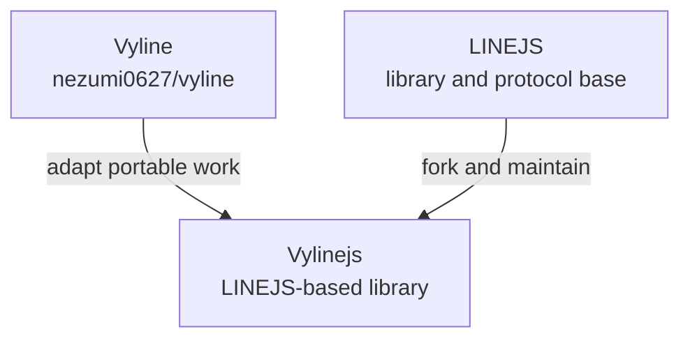
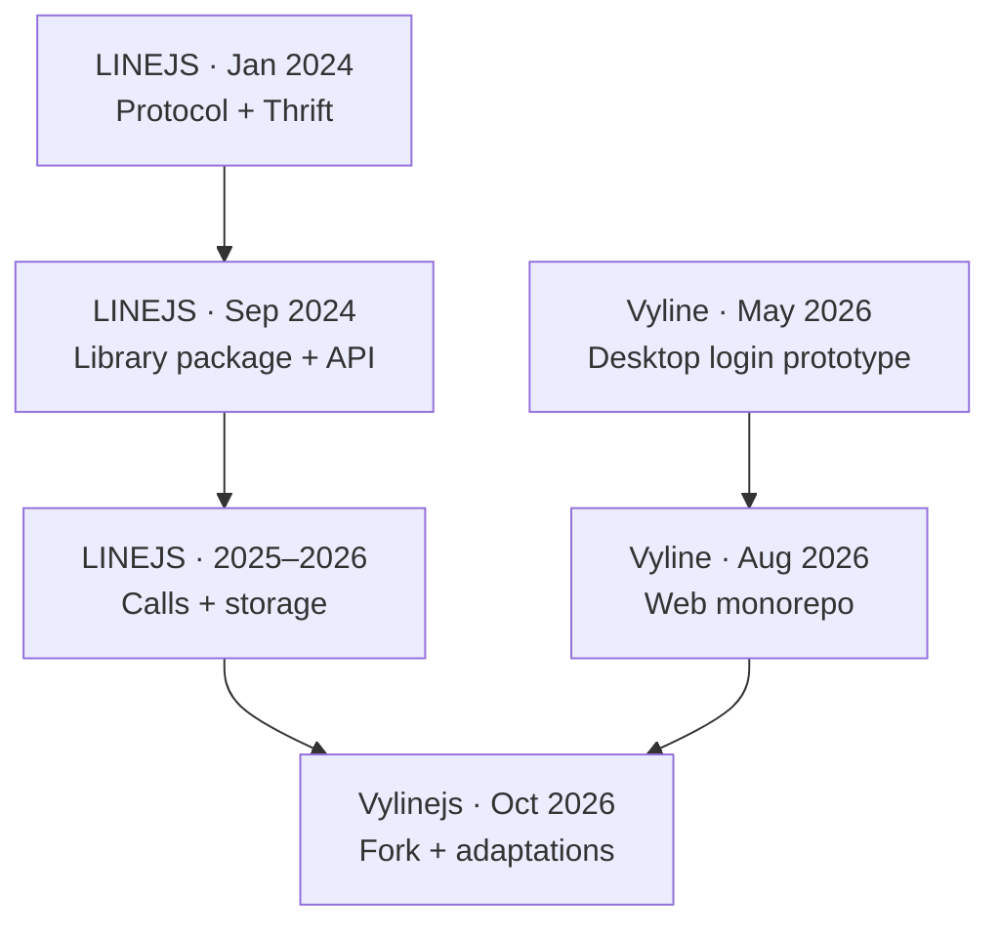
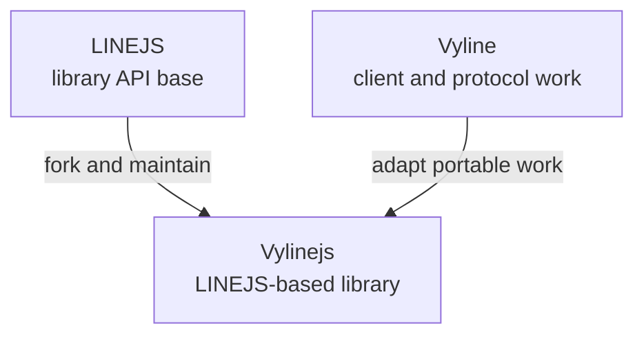

# Vyline → Vylinejs → LINEJS

Vylinejs is a downstream fork of LINEJS that adapts reusable protocol work from Vyline. The ancestry is explicit: Vylinejs descends from LINEJS; Vyline is a source of independently developed implementation experience, not an ancestor of the fork.

## E2EE and login parity

Baseline synced on 2026-10-20 from LINEJS `4fc512a` (`upstream/main`). The initial suspected gaps were checked against the actual code after syncing:

| Capability | LINEJS baseline | Vyline-specific remainder | Vylinejs action |
| --- | --- | --- | --- |
| QR/ForSecure and E2EE login | Already implemented | Desktop identity values and request transport are client-specific | No duplicate port |
| Login keychain history, exact key ID selection, keypair verification, and post-auth server verification | Already implemented in [`c47abfa`](https://github.com/evex-dev/linejs/commit/c47abfa) | Vyline also imports its local Desktop dump | Added an explicit stored-key reconciliation API; desktop dump parsing stays outside core |
| Group message key history by group key ID | Already implemented in [`ffd88cb`](https://github.com/evex-dev/linejs/commit/ffd88cb) | Vyline adds group recovery/cache policy around its client | No duplicate port |
| Choose newest locally available key that matches a server-registered public key; keep older verified keys; avoid automatic identity rotation | No single public reconciliation operation | `ensureValidE2EEIdentity` in [Vyline](https://github.com/nezumi0627/vyline/blob/main/Vyline/packages/protocol/src/login/ensureE2EE.ts) | `E2EE.reconcileStoredE2EEIdentity(mid)` added in Vylinejs |

`reconcileStoredE2EEIdentity(mid)` verifies each stored private key against the server public key with the same key ID, keeps verified historical entries, selects the highest matching ID as the `mid` alias, and reports whether that selection is behind the server's newest ID. If none match, it removes only the alias and leaves per-ID material intact. It never registers or rotates keys. Callers can import key material through the existing `saveE2EESelfKeyDataByKeyId` API, then explicitly reconcile.

Vyline's Desktop key dump parser, device fingerprinting, and transport patches remain app-level adapters. They must not be copied into the general library without a portable input contract and a separate review.

## Differences at a glance

LINEJS, Vyline, and Vylinejs solve different problems. LINEJS is a reusable JavaScript library; Vyline is a self-hostable LINE client application; Vylinejs is a LINEJS-based library that adapts portable work from Vyline while preserving familiar library entry points.

| | LINEJS | Vyline | Vylinejs |
| --- | --- | --- | --- |
| Main purpose | Build LINE client and automation programs as a library | Use LINE through a web client, desktop builds, or self-hosted server | Build LINE programs with a LINEJS-compatible library and fork-specific fixes |
| Starting point | Community library and protocol implementation | nezumi0627's application project | Fork of `evex-dev/linejs` |
| User-facing UI | No bundled chat application | React/Vite client | No bundled chat application |
| Runtime shape | Library for Node.js, Deno, and Bun | Bun backend and web frontend; Docker and desktop packaging workflows | Deno-first library, retaining Node.js/Bun support where the underlying interfaces allow |
| Protocol and login | Shared LINE protocol features maintained by upstream contributors | Own protocol stack, account/session lifecycle, E2EE, and app-specific login flows | LINEJS API baseline plus adapted session restore, E2EE identity reconciliation, and Vyline call/media work |
| Extension surface | Library APIs and packages | HTTP API, CLI, plugins, themes, and self-hosting | Library APIs, examples, and protocol modules |
| Change flow | Upstream changes land here first | Product and application changes are developed in Vyline | Syncs the library baseline and adapts portable Vyline behavior |
| Compatibility | Canonical upstream package and API | Application-level compatibility is managed by Vyline | Uses Vylinejs-owned package names; API shapes stay familiar where practical, with migration notes and service-specific limits |

The short version is: choose **LINEJS** when the upstream library is the target, **Vyline** when a complete client application is wanted, and **Vylinejs** when the library workflow is preferred with this fork's additional adaptations. These projects are not interchangeable releases: Vyline's UI, account manager, and server are not included in Vylinejs.

Performance is also described at different levels. Vylinejs publishes measured library-path changes and benchmark limits in the [stability notes](VYLINEJS_STABILITY.md). Vyline's end-user responsiveness depends on the full application, its host, the LINE service, and the selected deployment; the existence of a feature in Vyline does not by itself establish that Vylinejs is faster or supports the same user workflow.

## Project history and turning points

This timeline distinguishes repository ancestry from later code and idea reuse. Dates below are GitHub commit or issue dates, not claims about when private experimentation began.

### LINEJS: from protocol investigation to reusable library

The public LINEJS Git history starts on 2024-01-23. Its earliest commits are mostly uploads and small experiments around LINE Thrift data; two days later, the history includes deletion of early standalone parsing scripts and creation of server notes. This points to a project that began by probing and documenting the protocol, then consolidated the working code into a library. That is an interpretation of the commit sequence; the repository does not publish a formal origin story.

By September 2024, the history shows package extraction and features such as message utilities, Timeline/OBS support, and device handling. The current package layout separates client, base, call, thrift, storage, and shared types, and the README documents Node.js, Deno, and Bun. The current README credits Piloking as owner/developer and EdamAme-x, MocA-Love, and Hafusun as developers; it also names CHRLINE and related repositories as references. These credits support a community-maintained lineage, while not proving that any one reference supplied a specific implementation.

One useful example of how user proposals entered that history is [Issue #29, opened by nezumi0627 on 2024-09-11](https://github.com/evex-dev/linejs/issues/29). It proposed `sendLiff`, consent authorization, and issuing LIFF views to make rich content and LIFF flows more customizable. The discussion records that some pieces already existed or were implemented later; in May 2026, the issue was closed with the `issueLiffView` surface and the consent retry flow documented. This is evidence of a proposal-to-maintenance path spanning multiple releases, not evidence that Vyline itself originated LIFF support.

### Vyline: from desktop prototype to integrated client platform

The public Vyline repository starts on 2026-05-17 with `Initial commit: Vyline Tauri + React Hello World`; the next commit adds a login screen supporting primary and secondary device login. That establishes the visible starting point as an application project rather than a fork of LINEJS or a standalone protocol library. The repository later accumulated its own protocol package, E2EE, backend, UI, and deployment code. Public history cannot establish whether related private experiments predated that initial commit.

On 2026-08-16, commit [`6a7f10a6`](https://github.com/nezumi0627/vyline/commit/6a7f10a6) restructures the project as a web monorepo and drops the Tauri desktop traces. That is a meaningful architectural turn: the project shifts from a desktop-shell-first prototype toward a browser client backed by a server-side LINE protocol stack. Subsequent README architecture describes React/Vite, a Hono-on-Bun backend, a protocol package, shared line types, and a CLI. The public API, Docker/self-hosting, and `vyl` setup/diagnostic commands make the repository a client platform, not just a UI.

The breadth created a different maintenance concern from LINEJS. Vyline owns application lifecycle, account state, persistence, UI, server routes, protocol behavior, CLI, and the `vyline-search` tooling relationship. Its own commits repeatedly address resource cleanup, session persistence, and cache lifetime. Inference: that integrated scope gives Vyline room to make product-level decisions quickly, while also increasing the coordination and regression surface compared with a focused protocol library.

### Convergence: why Vylinejs exists

Vylinejs is the later bridge between those projects, not a claim that Vyline descended from LINEJS. It retains LINEJS's library/API base and adapts portable behavior learned in the application: session restore and refresh, E2EE identity reconciliation, group-call media paths, bounded queues, and measured copy reductions. The application-only pieces—UI, account manager, desktop identity/dump handling, and deployment policy—remain in Vyline unless a general library contract can be defined.

The relationship is selective reuse: LINEJS supplies the library base; Vyline supplies independently built application and protocol experience; Vylinejs adapts what fits the library boundary. This does not imply that every Vyline feature is already in Vylinejs.

### Primary history sources

- [LINEJS repository and README](https://github.com/evex-dev/linejs): purpose, package description, authors, and references.
- [LINEJS commit history](https://github.com/evex-dev/linejs/commits/main/): project evolution and package changes.
- [LINEJS Issue #29](https://github.com/evex-dev/linejs/issues/29): LIFF proposal and implementation follow-up by nezumi0627 and maintainers.
- [Vyline repository](https://github.com/nezumi0627/vyline): current project architecture and capabilities.
- [Vyline initial commit](https://github.com/nezumi0627/vyline/commit/f09bf48e7c209080f9afe691f2a1d0efaa146c59) and [login screen commit](https://github.com/nezumi0627/vyline/commit/34248c1e): public starting point.
- [Vyline web-monorepo restructuring](https://github.com/nezumi0627/vyline/commit/6a7f10a6): desktop-to-web architecture change.

## Adaptation workflow

1. Compare the current LINEJS-based implementation with the corresponding Vyline behavior.
2. Adapt only behavior that fits a reusable library API.
3. Keep app-specific account, UI, and deployment policy in Vyline.
4. Record the implementation source and local verification in this repository.

## Current change

- Source behavior: Vyline `ensureValidE2EEIdentity` (identity reconciliation).
- Adaptation: uses LINEJS storage, server key types, and its existing keypair verifier; Desktop dump import remains an external caller responsibility.

## Login, credential restore, and runtime identity comparison (2026-10-20)

The current LINEJS baseline already has password login v1/v2 branches, stores
the v2 refresh token and refresh deadline, and retries once after
`MUST_REFRESH_V3_TOKEN`. Its storage path did not save the access token, did
not offer a library-level restore helper, did not refresh near expiry before
profile loading, and concurrent requests could race a rotated refresh token.
The v2 password flow itself matches `tqmane/vyline-api`; the material gaps were
its fixed `114514` default PIN and logging credential-bearing request/response
objects.

Vyline's app-level session implementation stores an account-scoped access token
and separate protocol storage, protects credentials with the OS secure store
(with restricted file permissions), restores using the refresh token near its
configured deadline, and schedules proactive refresh every 60 seconds with a
configurable lead time and five-minute retry backoff. Vylinejs checks the
server deadline before authenticated requests and during stored-session
restore, and now schedules one unreferenced timer at the server refresh
deadline with a five-minute retry after failure. Account management, OS storage,
and Vyline's configurable periodic scheduler remain app-level policies.
`tqmane/vyline-api` independently adds a
single-flight refresh and redacted RPC logs to the shared protocol stack.

| Gap or behavior | Vyline / tqmane source | Vylinejs adaptation |
| --- | --- | --- |
| Stored-session restore | [Vyline clientManager](https://github.com/nezumi0627/vyline/blob/main/Vyline/backend/src/line/clientManager.ts), [tokenStore](https://github.com/nezumi0627/vyline/blob/main/Vyline/backend/src/storage/tokenStore.ts) | Persist `accessToken`; add explicit `loginWithStoredAuthToken`; refresh on authenticated requests within 60 seconds of expiry |
| Rotating / concurrent refresh | [tqmane AuthService](https://github.com/tqmane/vyline-api/blob/main/stack/base/service/auth/mod.ts) | Single-flight refresh; save rotated refresh token and deadline before exposing the new access token |
| Password PIN | [tqmane login source](https://github.com/tqmane/vyline-api/blob/main/stack/base/login/mod.ts) | CSPRNG six-digit default, numeric validation; password v2 flow retained |
| Account/session replacement | Vyline account-keyed credential records | Clear stale refresh state when credentials have no refresh token; remove saved credentials on logout |
| Device identity | [tqmane device defaults](https://github.com/tqmane/vyline-api/blob/main/stack/base/core/utils/devices.ts), [request UA](https://github.com/tqmane/vyline-api/blob/main/stack/base/request/mod.ts) | Match iOS/iPadOS 26.12.1 / 26.1; Android 26.6.2 / Android 16 already matches; retain the desktop-specific User-Agent format and explicit `version` override |
| Secret-bearing logs | [tqmane request logger](https://github.com/tqmane/vyline-api/blob/main/stack/base/request/mod.ts) | Log method, status, and byte counts only; omit auth headers, Thrift bodies, and response payloads |

The request layer now preserves the original timeout when retrying after a
server-mandated refresh and fails explicitly if the retry still requires a
refresh. `NOT_AUTHORIZED_DEVICE` clears access and refresh credentials before
the shared error is thrown; this ordering was corrected during the audit.

`FileStorage` is a user-provided persistence adapter and writes plaintext JSON;
the documentation warns that session files contain tokens and E2EE material.
This does not claim the same at-rest protection as Vyline's app-level secure
store. The explicit restore helper requires the same persistent storage object
to be supplied on each run.

## Tqmane call-processing gap review

The synced LINEJS call package already contains SIP/SRTP, PLANET/Cassini,
1:1 call sessions, group-call route/service methods, and incoming-call handling.
Tqmane's current `vyline-api` stack adds a coupled group-media layer that is
absent from the synced upstream tree:

| Tqmane-only call modules | Responsibility |
| --- | --- |
| `planet/conference.ts` | Decode and track group conference members and source state |
| `planet/eas2.ts`, `planet/xrtp.ts` | Group audio packet framing and multiplexed RTP extensions |
| `planet/pdtp.ts` | Group data transport and retransmission state |
| `planet/evs3.ts`, `planet/svc.ts` | VP8 video framing, SVC layer handling, and bounded assembly |
| `groupAudio.ts` | Decode, buffer, and mix participant audio |

EAS2/XRTP receive, conference snapshots/pushes, and participant audio mixing
are now adapted in `planet/eas2.ts`, `planet/xrtp.ts`,
`planet/conference.ts`, `planet/transport.ts`, `groupAudio.ts`, and `session.ts`.
`CallSession` accepts an acquired `GroupCallRoute`, joins the room, exposes
mixed 48 kHz PCM through `received()`, and emits participant roster changes.
The port preserves LINEJS's existing PLANET signaling, SRTP receive-key
selection, derives separate DATA SRTP keys, and handles reliable PLANET notifier
PDTP packets, reassembly, credit updates, and acknowledgements. Video SVC and
EVS3 receive are adapted with roster-driven subscriptions, separate VIDEO SRTP,
SVC VP8 normalization, bounded frame assembly, and source MID attribution.
The call API transmits caller-supplied encoded VP8 frames through `sendVideo()`;
camera capture, encoding, pacing, and keyframe production remain the caller's
responsibility. Camera state/UI remain outside the protocol library. The source snapshot
reviewed for this port is [`tqmane/vyline-api@600fccd`](https://github.com/tqmane/vyline-api/tree/600fccde62273b83b173ac250dc72197ff6a1dfc/stack/client/features/call), a fork of
[nezumi0627/vyline-api](https://github.com/nezumi0627/vyline-api). Copied modules retain the required
original-author credit and MIT terms in
[`docs/licenses/tqmane-vyline-api-MIT.txt`](licenses/tqmane-vyline-api-MIT.txt).
