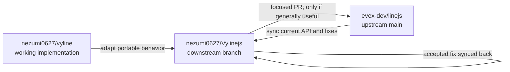

# Vyline → Vylinejs → LINEJS

Vylinejs is a downstream fork of LINEJS that adapts reusable protocol work from Vyline. The ancestry is explicit: Vylinejs descends from LINEJS; Vyline is a source of independently developed implementation experience, not an ancestor of the fork.

## E2EE and login parity

Baseline synced on 2026-10-20 from LINEJS `4fc512a` (`upstream/main`). The initial suspected gaps were checked against the actual code after syncing:

| Capability | LINEJS baseline | Vyline-specific remainder | Vylinejs action |
| --- | --- | --- | --- |
| QR/ForSecure and E2EE login | Already implemented | Desktop identity values and request transport are client-specific | No duplicate port |
| Login keychain history, exact key ID selection, keypair verification, and post-auth server verification | Already implemented in [`c47abfa`](https://github.com/evex-dev/linejs/commit/c47abfa) | Vyline also imports its local Desktop dump | Added an explicit stored-key reconciliation API; desktop dump parsing stays outside core |
| Group message key history by group key ID | Already implemented in [`ffd88cb`](https://github.com/evex-dev/linejs/commit/ffd88cb) | Vyline adds group recovery/cache policy around its client | No duplicate port |
| Choose newest locally available key that matches a server-registered public key; keep older verified keys; avoid automatic identity rotation | No single public reconciliation operation | `ensureValidE2EEIdentity` in [Vyline](https://github.com/nezumi0627/vyline/blob/main/Vyline/packages/protocol/src/login/ensureE2EE.ts) | `E2EE.reconcileStoredE2EEIdentity(mid)` added in Vylinejs |

`reconcileStoredE2EEIdentity(mid)` verifies each stored private key against the server public key with the same key ID, keeps verified historical entries, selects the highest matching ID as the `mid` alias, and reports whether that selection is behind the server's newest ID. If none match, it removes only the alias and leaves per-ID material intact. It never registers or rotates keys. Callers can import key material through the existing `saveE2EESelfKeyDataByKeyId` API, then explicitly reconcile.

Vyline's Desktop key dump parser, device fingerprinting, and transport patches remain app-level adapters. They must not be copied into the general library without a portable input contract and a separate review.

## Contribution loop

1. Sync and inspect current `upstream/main` before starting each port.
2. Record the Vyline source, adaptation, behavior change, and verification here or in a focused change note.
3. Keep one portable behavior per branch and avoid importing app-specific policy into the core.
4. Propose generally useful changes as focused PRs to `evex-dev/linejs`; record their URL and status.
5. Sync accepted upstream changes back into Vylinejs and remove downstream duplicates.

## Current change

- Source behavior: Vyline `ensureValidE2EEIdentity` (identity reconciliation).
- Adaptation: uses LINEJS storage, server key types, and existing keypair verifier; Desktop dump import remains an external caller responsibility.
- Upstream PR: not opened; local implementation is under review on `feat/e2ee-keychain-history`.

## Login, credential restore, and runtime identity comparison (2026-10-20)

The current LINEJS baseline already has password login v1/v2 branches, stores
the v2 refresh token and refresh deadline, and retries once after
`MUST_REFRESH_V3_TOKEN`. Its storage path did not save the access token, did
not offer a library-level restore helper, did not refresh near expiry before
profile loading, and concurrent requests could race a rotated refresh token.
The v2 password flow itself matches `tqmane/vyline-api`; the material gaps were
its fixed `114514` default PIN and logging credential-bearing request/response
objects.

Vyline's app-level session implementation stores an account-scoped access token
and separate protocol storage, protects credentials with the OS secure store
(with restricted file permissions), restores using the refresh token near its
configured deadline, and schedules proactive refresh every 60 seconds with a
configurable lead time and five-minute retry backoff. Vylinejs checks the
server deadline before authenticated requests and during stored-session
restore, and now schedules one unreferenced timer at the server refresh
deadline with a five-minute retry after failure. Account management, OS storage,
and Vyline's configurable periodic scheduler remain app-level policies.
`tqmane/vyline-api` independently adds a
single-flight refresh and redacted RPC logs to the shared protocol stack.

| Gap or behavior | Vyline / tqmane source | Vylinejs adaptation |
| --- | --- | --- |
| Stored-session restore | [Vyline clientManager](https://github.com/nezumi0627/vyline/blob/main/Vyline/backend/src/line/clientManager.ts), [tokenStore](https://github.com/nezumi0627/vyline/blob/main/Vyline/backend/src/storage/tokenStore.ts) | Persist `accessToken`; add explicit `loginWithStoredAuthToken`; refresh on authenticated requests within 60 seconds of expiry |
| Rotating / concurrent refresh | [tqmane AuthService](https://github.com/tqmane/vyline-api/blob/main/stack/base/service/auth/mod.ts) | Single-flight refresh; save rotated refresh token and deadline before exposing the new access token |
| Password PIN | [tqmane login source](https://github.com/tqmane/vyline-api/blob/main/stack/base/login/mod.ts) | CSPRNG six-digit default, numeric validation; password v2 flow retained |
| Account/session replacement | Vyline account-keyed credential records | Clear stale refresh state when credentials have no refresh token; remove saved credentials on logout |
| Device identity | [tqmane device defaults](https://github.com/tqmane/vyline-api/blob/main/stack/base/core/utils/devices.ts), [request UA](https://github.com/tqmane/vyline-api/blob/main/stack/base/request/mod.ts) | Match iOS/iPadOS 26.12.1 / 26.1; Android 26.6.2 / Android 16 already matches; retain the desktop-specific User-Agent format and explicit `version` override |
| Secret-bearing logs | [tqmane request logger](https://github.com/tqmane/vyline-api/blob/main/stack/base/request/mod.ts) | Log method, status, and byte counts only; omit auth headers, Thrift bodies, and response payloads |

The request layer now preserves the original timeout when retrying after a
server-mandated refresh and fails explicitly if the retry still requires a
refresh. `NOT_AUTHORIZED_DEVICE` clears access and refresh credentials before
the shared error is thrown; this ordering was corrected during the audit.

`FileStorage` is a user-provided persistence adapter and writes plaintext JSON;
the documentation warns that session files contain tokens and E2EE material.
This does not claim the same at-rest protection as Vyline's app-level secure
store. The explicit restore helper requires the same persistent storage object
to be supplied on each run.

## Tqmane call-processing gap review

The synced LINEJS call package already contains SIP/SRTP, PLANET/Cassini,
1:1 call sessions, group-call route/service methods, and incoming-call handling.
Tqmane's current `vyline-api` stack adds a coupled group-media layer that is
absent from the synced upstream tree:

| Tqmane-only call modules | Responsibility |
| --- | --- |
| `planet/conference.ts` | Decode and track group conference members and source state |
| `planet/eas2.ts`, `planet/xrtp.ts` | Group audio packet framing and multiplexed RTP extensions |
| `planet/pdtp.ts` | Group data transport and retransmission state |
| `planet/evs3.ts`, `planet/svc.ts` | VP8 video framing, SVC layer handling, and bounded assembly |
| `groupAudio.ts` | Decode, buffer, and mix participant audio |

EAS2/XRTP receive, conference snapshots/pushes, and participant audio mixing
are now adapted in `planet/eas2.ts`, `planet/xrtp.ts`,
`planet/conference.ts`, `planet/transport.ts`, `groupAudio.ts`, and `session.ts`.
`CallSession` accepts an acquired `GroupCallRoute`, joins the room, exposes
mixed 48 kHz PCM through `received()`, and emits participant roster changes.
The port preserves LINEJS's existing PLANET signaling, SRTP receive-key
selection, derives separate DATA SRTP keys, and handles reliable PLANET notifier
PDTP packets, reassembly, credit updates, and acknowledgements. Video SVC and
EVS3 receive are adapted with roster-driven subscriptions, separate VIDEO SRTP,
SVC VP8 normalization, bounded frame assembly, and source MID attribution.
The call API transmits caller-supplied encoded VP8 frames through `sendVideo()`;
camera capture, encoding, pacing, and keyframe production remain the caller's
responsibility. Camera state/UI remain outside the protocol library. The source snapshot
reviewed for this port is [`tqmane/vyline-api@600fccd`](https://github.com/tqmane/vyline-api/tree/600fccde62273b83b173ac250dc72197ff6a1dfc/stack/client/features/call), a fork of
[nezumi0627/vyline-api](https://github.com/nezumi0627/vyline-api). Copied modules retain the required
original-author credit and MIT terms in
[`docs/licenses/tqmane-vyline-api-MIT.txt`](licenses/tqmane-vyline-api-MIT.txt).
