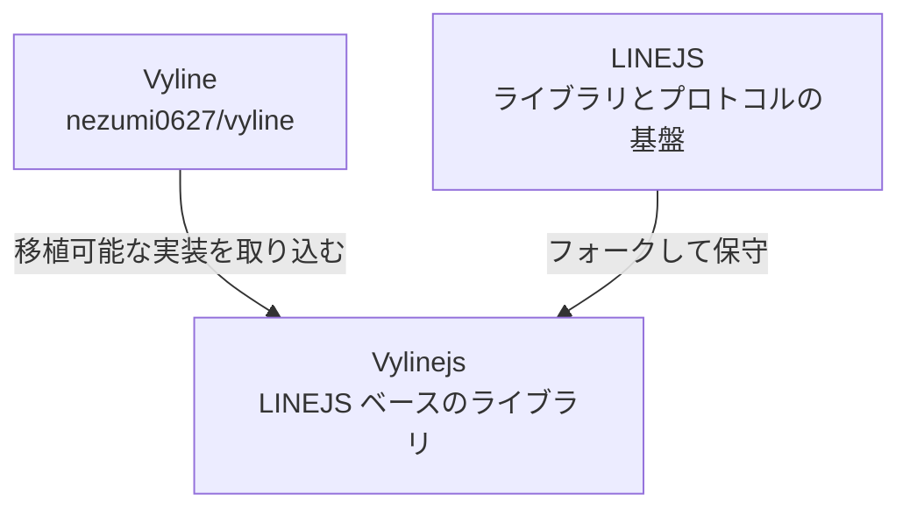
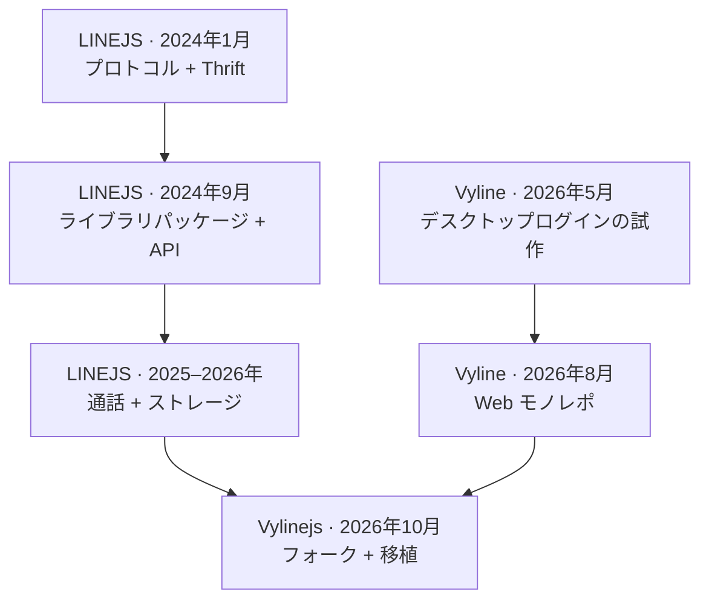
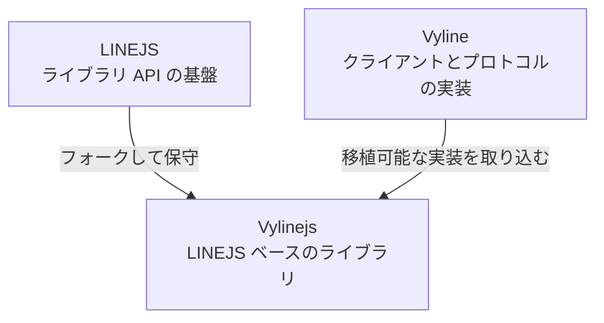

# Vyline → Vylinejs → LINEJS {#vyline-→-vylinejs-→-linejs}

Vylinejs は LINEJS の下流フォークで、Vyline の再利用可能なプロトコル実装を取り入れています。
派生関係は明確です。Vylinejs の派生元は LINEJS であり、Vyline は独自に開発した実装の知見を提供するプロジェクトであって、このフォークの派生元ではありません。

## E2EE とログインの機能比較 {#e2ee-and-login-parity}

2026-10-20 に LINEJS `4fc512a`（`upstream/main`）からベースラインを同期しました。
当初、不足が疑われていた機能を、同期後の実際のコードで確認しました。

| 機能 | LINEJS のベースライン | Vyline 固有の残りの部分 | Vylinejs での対応 |
| --- | --- | --- | --- |
| QR/ForSecure と E2EE ログイン | 実装済み | デスクトップの識別値とリクエストのトランスポートはクライアント固有 | 重複する移植は行わない |
| ログイン時のキーチェーン履歴、正確なキー ID の選択、鍵ペアの検証、認証後のサーバー検証 | [`c47abfa`](https://github.com/evex-dev/linejs/commit/c47abfa) で実装済み | Vyline はローカルの Desktop ダンプもインポートする | 保存済み鍵を明示的に照合する API を追加。デスクトップダンプの解析はコアの外に置く |
| グループキー ID ごとのグループメッセージ鍵履歴 | [`ffd88cb`](https://github.com/evex-dev/linejs/commit/ffd88cb) で実装済み | Vyline はクライアント側にグループの復旧とキャッシュのポリシーを追加している | 重複する移植は行わない |
| サーバー登録済み公開鍵と一致するローカルの最新鍵を選択し、検証済みの古い鍵を保持し、アイデンティティを自動ローテーションしない | 一括して照合する公開操作はない | [Vyline](https://github.com/nezumi0627/vyline/blob/main/Vyline/packages/protocol/src/login/ensureE2EE.ts) の `ensureValidE2EEIdentity` | Vylinejs に `E2EE.reconcileStoredE2EEIdentity(mid)` を追加 |

`reconcileStoredE2EEIdentity(mid)` は、保存済みの各秘密鍵を同じキー ID のサーバー公開鍵と照合し、検証済みの履歴エントリーを保持します。
一致する ID のうち最大のものを `mid` エイリアスとして選び、その選択がサーバーの最新 ID より古いかどうかを報告します。
一致する鍵がない場合は、エイリアスだけを削除し、ID ごとの鍵データは残します。
鍵の登録やローテーションは行いません。
呼び出し側は既存の `saveE2EESelfKeyDataByKeyId` API で鍵データをインポートしてから、明示的に照合できます。

Vyline の Desktop 鍵ダンプパーサー、デバイスフィンガープリント処理、トランスポートのパッチは、引き続きアプリケーション層のアダプターです。
移植可能な入力契約と個別のレビューなしに、汎用ライブラリへコピーしてはいけません。

## 主な違い {#differences-at-a-glance}

LINEJS、Vyline、Vylinejs はそれぞれ異なる問題を解決します。
LINEJS は再利用可能な JavaScript ライブラリ、Vyline はセルフホスト可能な LINE クライアントアプリケーションです。
Vylinejs は、なじみのあるライブラリのエントリーポイントを維持しながら、Vyline の移植可能な実装を取り込む LINEJS ベースのライブラリです。

| | LINEJS | Vyline | Vylinejs |
| --- | --- | --- | --- |
| 主な目的 | ライブラリとして LINE クライアントや自動化プログラムを構築する | Web クライアント、デスクトップビルド、セルフホストサーバーから LINE を利用する | LINEJS 互換ライブラリとフォーク固有の修正を使って LINE プログラムを構築する |
| 出発点 | コミュニティのライブラリとプロトコル実装 | nezumi0627 のアプリケーションプロジェクト | `evex-dev/linejs` のフォーク |
| ユーザー向け UI | チャットアプリケーションは同梱しない | React/Vite クライアント | チャットアプリケーションは同梱しない |
| 実行環境の構成 | Node.js、Deno、Bun 向けのライブラリ | Bun バックエンドと Web フロントエンド。Docker とデスクトップのパッケージ化ワークフロー | Deno を第一に扱うライブラリ。基盤となるインターフェースで可能な範囲で Node.js/Bun 対応を維持 |
| プロトコルとログイン | 上流の貢献者が保守する共通の LINE プロトコル機能 | 独自のプロトコルスタック、アカウントとセッションのライフサイクル、E2EE、アプリケーション固有のログインフロー | LINEJS API のベースラインに、移植したセッション復元、E2EE アイデンティティ照合、Vyline の通話とメディアの実装を追加 |
| 拡張の接点 | ライブラリ API とパッケージ | HTTP API、CLI、プラグイン、テーマ、セルフホスト | ライブラリ API、サンプル、プロトコルモジュール |
| 変更の流れ | 上流の変更が最初に入る | プロダクトとアプリケーションの変更を Vyline で開発する | ライブラリのベースラインを同期し、Vyline の移植可能な動作を取り込む |
| 互換性 | 正式な上流パッケージと API | アプリケーション層の互換性は Vyline が管理する | Vylinejs 独自のパッケージ名を使用。実用的な範囲でなじみのある API の形を保ち、移行ノートとサービス固有の制限を示す |

上流のライブラリを使いたい場合は **LINEJS**、完成したクライアントアプリケーションが必要な場合は **Vyline**、ライブラリとしての利用にこのフォーク独自の移植機能を加えたい場合は **Vylinejs** を選びます。
これらは相互に置き換えられるリリースではありません。Vyline の UI、アカウントマネージャー、サーバーは Vylinejs に含まれません。

性能についても、扱う範囲が異なります。
Vylinejs は、ライブラリ内の処理で測定した変更とベンチマークの限界を[安定性ノート](VYLINEJS_STABILITY.md)で公開しています。
Vyline の利用者が感じる応答性は、アプリケーション全体、ホスト環境、LINE サービス、選択したデプロイ構成に依存します。
Vyline に機能が存在することだけでは、Vylinejs の方が高速であることや、同じ利用手順に対応することの証明にはなりません。

## プロジェクトの歴史と転換点 {#project-history-and-turning-points}

この年表では、リポジトリの派生関係と、その後のコードやアイデアの再利用を区別します。
以下の日付は GitHub のコミットまたは Issue の日付であり、非公開の実験を始めた時期を示すものではありません。

### LINEJS：プロトコル調査から再利用可能なライブラリへ {#linejs-from-protocol-investigation-to-reusable-library}

LINEJS の公開 Git 履歴は 2024-01-23 に始まります。
最初期のコミットは主に LINE の Thrift データに関するアップロードや小規模な実験で、2日後の履歴には初期の単独解析スクリプトの削除とサーバーノートの作成が含まれます。
この流れから、プロトコルの調査と記録から始まり、動作するコードをライブラリに集約していったプロジェクトだと考えられます。
これはコミットの並びに基づく解釈であり、リポジトリが正式な誕生経緯を公開しているわけではありません。

2024年9月までには、パッケージの切り出しや、メッセージユーティリティ、Timeline/OBS 対応、デバイス処理といった機能が履歴に現れます。
現在のパッケージ構成では client、base、call、thrift、storage、共通型が分離され、README には Node.js、Deno、Bun の説明があります。
現在の README は Piloking をオーナー兼開発者、EdamAme-x、MocA-Love、Hafusun を開発者として記載し、CHRLINE と関連リポジトリを参考資料として挙げています。
これらのクレジットはコミュニティによる保守の系譜を裏付けますが、特定の参考資料が特定の実装の供給元であることまでは証明しません。

利用者の提案がこの歴史に入った例として、[nezumi0627 が 2024-09-11 に作成した Issue #29](https://github.com/evex-dev/linejs/issues/29) があります。
リッチコンテンツと LIFF のフローをより柔軟にするため、`sendLiff`、同意の認可、LIFF ビューの発行を提案したものです。
議論には、一部がすでに存在していたことや、後から実装されたことが記録されています。
2026年5月には `issueLiffView` API と同意の再試行フローの説明が記載され、Issue がクローズされました。
これは複数のリリースにまたがる提案から保守への流れを示す証拠であり、Vyline 自体が LIFF 対応の起源であることを示すものではありません。

### Vyline：デスクトップの試作から統合クライアント基盤へ {#vyline-from-desktop-prototype-to-integrated-client-platform}

Vyline の公開リポジトリは、2026-05-17 の `Initial commit: Vyline Tauri + React Hello World` から始まります。
次のコミットでは、プライマリデバイスとセカンダリデバイスのログインに対応するログイン画面が追加されます。
この公開上の出発点は、LINEJS のフォークや独立したプロトコルライブラリではなく、アプリケーションプロジェクトです。
その後、リポジトリには独自のプロトコルパッケージ、E2EE、バックエンド、UI、デプロイ用コードが蓄積されました。
関連する非公開の実験が最初のコミット以前に存在したかどうかは、公開履歴からは確定できません。

2026-08-16 のコミット [`6a7f10a6`](https://github.com/nezumi0627/vyline/commit/6a7f10a6) は、プロジェクトを Web モノレポに再構成し、Tauri デスクトップの痕跡を取り除いています。
これは、デスクトップシェルを中心とする試作から、サーバー側の LINE プロトコルスタックを背後に持つブラウザークライアントへの構造上の転換です。
その後の README の構成説明には、React/Vite、Hono-on-Bun バックエンド、プロトコルパッケージ、共通の LINE 型、CLI が登場します。
公開 API、Docker とセルフホストへの対応、`vyl` のセットアップと診断コマンドにより、このリポジトリは UI だけでなくクライアント基盤になっています。

この広い範囲は、LINEJS とは異なる保守上の課題を生みました。
Vyline はアプリケーションのライフサイクル、アカウント状態、永続化、UI、サーバールート、プロトコルの動作、CLI、`vyline-search` ツール群との連携を受け持ちます。
コミットでは、リソースの解放、セッションの永続化、キャッシュの寿命への対応が繰り返されています。
ここからの推論として、この統合範囲はプロダクト全体の判断を素早く行う余地を Vyline に与える一方、プロトコルに対象を絞ったライブラリよりも調整や回帰確認の対象を増やしていると考えられます。

### 合流：Vylinejs が存在する理由 {#convergence-why-vylinejs-exists}

Vylinejs は後から両プロジェクトをつなぐものであり、Vyline が LINEJS から派生したと主張するものではありません。
LINEJS のライブラリと API の基盤を維持し、アプリケーションで得た移植可能な動作を取り込みます。対象は、セッション復元と更新、E2EE アイデンティティ照合、グループ通話のメディア処理、上限付きキュー、測定に基づくコピー削減です。
UI、アカウントマネージャー、デスクトップの識別情報とダンプ処理、デプロイポリシーといったアプリケーション専用の部分は、汎用ライブラリの契約を定義できない限り Vyline に残します。

この関係は選択的な再利用です。LINEJS がライブラリの基盤を提供し、Vyline が独自に構築したアプリケーションとプロトコルの知見を提供し、Vylinejs がライブラリの責務に収まるものを取り込みます。
Vyline のすべての機能がすでに Vylinejs にあるという意味ではありません。

### 歴史に関する一次資料 {#primary-history-sources}

- [LINEJS のリポジトリと README](https://github.com/evex-dev/linejs)：目的、パッケージの説明、著者、参考資料。
- [LINEJS のコミット履歴](https://github.com/evex-dev/linejs/commits/main/)：プロジェクトの変遷とパッケージの変更。
- [LINEJS Issue #29](https://github.com/evex-dev/linejs/issues/29)：nezumi0627 とメンテナーによる LIFF の提案と実装後の対応。
- [Vyline のリポジトリ](https://github.com/nezumi0627/vyline)：現在のプロジェクト構成と機能。
- [Vyline の最初のコミット](https://github.com/nezumi0627/vyline/commit/f09bf48e7c209080f9afe691f2a1d0efaa146c59) と[ログイン画面のコミット](https://github.com/nezumi0627/vyline/commit/34248c1e)：公開上の出発点。
- [Vyline の Web モノレポへの再構成](https://github.com/nezumi0627/vyline/commit/6a7f10a6)：デスクトップから Web への構成変更。

## 移植の手順 {#adaptation-workflow}

1. 現在の LINEJS ベースの実装を、対応する Vyline の動作と比較します。
2. 再利用可能なライブラリ API に収まる動作だけを移植します。
3. アプリケーション固有のアカウント、UI、デプロイのポリシーは Vyline に残します。
4. 実装の出典とローカルでの検証をこのリポジトリに記録します。

## 現在の変更 {#current-change}

- 元となる動作：Vyline の `ensureValidE2EEIdentity`（アイデンティティ照合）。
- 移植方法：LINEJS のストレージ、サーバーの鍵の型、既存の鍵ペア検証器を使用。Desktop ダンプのインポートは引き続き外部の呼び出し側が担当します。

## ログイン、認証情報の復元、実行時の識別情報の比較（2026-10-20） {#login-credential-restore-and-runtime-identity-comparison-2026-10-20}

現在の LINEJS ベースラインにはパスワードログインの v1/v2 分岐があり、v2 のリフレッシュトークンと更新期限を保存し、`MUST_REFRESH_V3_TOKEN` の後に1回再試行します。
そのストレージ処理はアクセストークンを保存せず、ライブラリ層の復元ヘルパーも提供していませんでした。
プロフィール読み込み前に期限が近いトークンを更新せず、同時リクエストでローテーションされたリフレッシュトークンの競合が起こる可能性もありました。
v2 のパスワードフロー自体は `tqmane/vyline-api` と一致します。実質的な不足は、デフォルト PIN が `114514` に固定されていたことと、認証情報を含むリクエストとレスポンスのオブジェクトをログに出力していたことです。

Vyline のアプリケーション層のセッション実装は、アカウント単位のアクセストークンと、別個のプロトコル用ストレージを保存します。
OS のセキュアストアで認証情報を保護し（ファイル権限も制限）、設定された期限が近づくとリフレッシュトークンを使って復元します。
また、先行更新の時間幅を設定できる60秒ごとの予防的な更新を行い、失敗時の再試行には5分のバックオフを設けます。
Vylinejs は認証済みリクエストの前と保存済みセッションの復元時にサーバーの期限を確認します。現在は、サーバーの更新期限に合わせてプロセスの存続を妨げないタイマーを1つ設定し、失敗時は5分後に再試行します。
アカウント管理、OS のストレージ、Vyline の設定可能な定期スケジューラーは、引き続きアプリケーション層のポリシーです。
`tqmane/vyline-api` は、共通のプロトコルスタックに対して独自に、同時更新の一本化と機密情報を伏せた RPC ログを追加しています。

| 不足または動作 | Vyline / tqmane の出典 | Vylinejs での移植 |
| --- | --- | --- |
| 保存済みセッションの復元 | [Vyline clientManager](https://github.com/nezumi0627/vyline/blob/main/Vyline/backend/src/line/clientManager.ts)、[tokenStore](https://github.com/nezumi0627/vyline/blob/main/Vyline/backend/src/storage/tokenStore.ts) | `accessToken` を永続化。明示的な `loginWithStoredAuthToken` を追加。有効期限まで60秒以内の認証済みリクエストで更新 |
| ローテーションと同時更新 | [tqmane AuthService](https://github.com/tqmane/vyline-api/blob/main/stack/base/service/auth/mod.ts) | 同時更新を一本化。新しいアクセストークンを公開する前に、ローテーションされたリフレッシュトークンと期限を保存 |
| パスワードの PIN | [tqmane のログイン実装](https://github.com/tqmane/vyline-api/blob/main/stack/base/login/mod.ts) | CSPRNG による6桁のデフォルト値と数値検証。パスワードの v2 フローは維持 |
| アカウントとセッションの置き換え | Vyline のアカウントをキーとする認証情報レコード | 認証情報にリフレッシュトークンがない場合は古い更新状態を消去。ログアウト時に保存済み認証情報を削除 |
| デバイスの識別情報 | [tqmane のデバイス初期値](https://github.com/tqmane/vyline-api/blob/main/stack/base/core/utils/devices.ts)、[リクエストの UA](https://github.com/tqmane/vyline-api/blob/main/stack/base/request/mod.ts) | iOS/iPadOS 26.12.1 / 26.1 に合わせる。Android 26.6.2 / Android 16 はすでに一致。デスクトップ固有の User-Agent 形式と明示的な `version` の上書きを維持 |
| 機密情報を含むログ | [tqmane のリクエストロガー](https://github.com/tqmane/vyline-api/blob/main/stack/base/request/mod.ts) | メソッド、ステータス、バイト数だけを記録。認証ヘッダー、Thrift 本文、レスポンスのペイロードは出力しない |

現在のリクエスト層は、サーバーが要求した更新の後に再試行するときも元のタイムアウトを維持し、再試行後も更新が必要なら明示的に失敗します。
`NOT_AUTHORIZED_DEVICE` では、共通のエラーをスローする前にアクセス用と更新用の認証情報を消去します。この順序は監査中に修正しました。

`FileStorage` は利用者が指定する永続化アダプターで、平文の JSON を書き込みます。
ドキュメントでは、セッションファイルにトークンと E2EE の鍵データが含まれることを警告しています。
Vyline のアプリケーション層のセキュアストアと同等の保存時保護をうたうものではありません。
明示的な復元ヘルパーには、実行のたびに同じ永続ストレージオブジェクトを渡す必要があります。

## Tqmane の通話処理との差分レビュー {#tqmane-call-processing-gap-review}

同期済みの LINEJS 通話パッケージには、SIP/SRTP、PLANET/Cassini、1対1の通話セッション、グループ通話のルートとサービスのメソッド、着信処理がすでに含まれています。
Tqmane の現在の `vyline-api` スタックは、同期した上流ツリーにはない、相互に結び付いたグループメディア層を追加しています。

| Tqmane のみにある通話モジュール | 役割 |
| --- | --- |
| `planet/conference.ts` | グループ会議のメンバーとソース状態をデコードして追跡 |
| `planet/eas2.ts`、`planet/xrtp.ts` | グループ音声パケットのフレーミングと多重化 RTP 拡張 |
| `planet/pdtp.ts` | グループのデータ転送と再送状態 |
| `planet/evs3.ts`、`planet/svc.ts` | VP8 動画のフレーミング、SVC レイヤーの処理、上限付きの組み立て |
| `groupAudio.ts` | 参加者音声のデコード、バッファリング、ミキシング |

現在、EAS2/XRTP の受信、会議のスナップショットとプッシュ、参加者音声のミキシングは、`planet/eas2.ts`、`planet/xrtp.ts`、`planet/conference.ts`、`planet/transport.ts`、`groupAudio.ts`、`session.ts` に移植されています。
`CallSession` は取得済みの `GroupCallRoute` を受け取ってルームに参加し、`received()` でミックス済みの 48 kHz PCM を公開し、参加者名簿の変更をイベントとして通知します。
この移植は LINEJS の既存の PLANET シグナリングと SRTP 受信鍵の選択を維持し、別個の DATA SRTP 鍵を導出します。また、信頼性を備えた PLANET notifier の PDTP パケット、再組み立て、クレジット更新、確認応答を処理します。
動画の SVC と EVS3 の受信には、参加者名簿に基づく購読、別個の VIDEO SRTP、SVC VP8 の正規化、上限付きフレーム組み立て、送信元 MID の特定を取り込んでいます。
通話 API は、呼び出し側が渡したエンコード済み VP8 フレームを `sendVideo()` で送信します。カメラキャプチャー、エンコード、送信ペースの制御、キーフレームの生成は引き続き呼び出し側の責務です。
カメラの状態と UI はプロトコルライブラリの範囲外です。
この移植でレビューしたソースのスナップショットは [`tqmane/vyline-api@600fccd`](https://github.com/tqmane/vyline-api/tree/600fccde62273b83b173ac250dc72197ff6a1dfc/stack/client/features/call) で、[nezumi0627/vyline-api](https://github.com/nezumi0627/vyline-api) のフォークです。
コピーしたモジュールには、必要な原著者のクレジットと MIT 条項を [`docs/licenses/tqmane-vyline-api-MIT.txt`](licenses/tqmane-vyline-api-MIT.txt) に保持しています。
